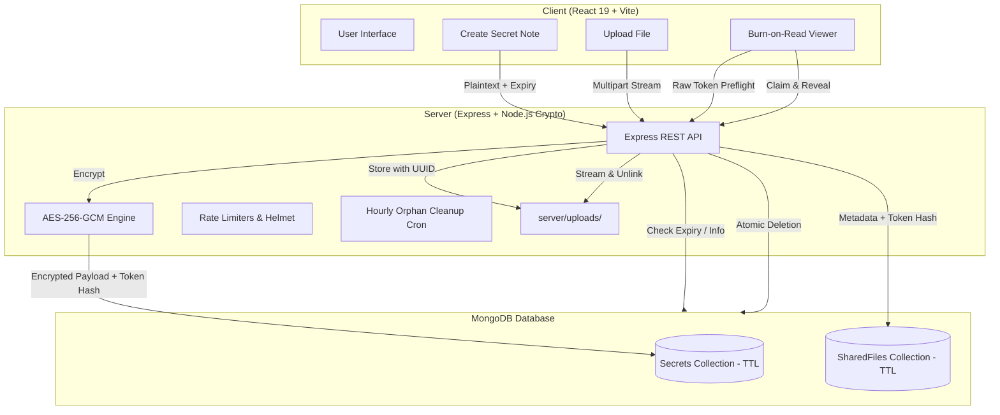

# WhisperShare 🛡️🔥

**WhisperShare** is a next-generation ephemeral data sharing platform engineered for zero-retention secrecy. It allows users to securely share confidential notes (passwords, private keys, API tokens) and sensitive files (up to 10 MB) via single-use, burn-on-read links.

Once a recipient opens and views or downloads the payload, the data is **permanently destroyed** from the database and disk storage.

---

## 🌟 Key Features

- **Burn-on-Read Note Destruction**: Messages are encrypted with authenticated **AES-256-GCM** using unique 96-bit nonces. Decryption occurs strictly upon recipient confirmation, followed by immediate atomic database erasure.
- **Single-Use File Sharing**: Upload documents, archives, or images up to 10 MB. Files are stored in unexposed server directories with randomized names and stream-deleted immediately upon download.
- **Atomic Deletion (No Race Conditions)**: Uses MongoDB atomic `findOneAndDelete` and single-use claim tickets, preventing duplicate claims or race conditions.
- **Token Hashing**: Links contain a raw 256-bit cryptographically random token. The backend stores **only the SHA-256 hash** of this token. Even if database storage were compromised, original tokens cannot be recovered.
- **Automated Dual Cleanup**:
  - MongoDB TTL indexes automatically purge expired metadata documents.
  - Background `node-cron` daemon routinely sweeps disk storage for orphaned files.
- **Hardened HTTP Security**: Protected with `helmet` security headers, strict IP rate limiters, `no-store` cache control headers, and sanitized filename handling.
- **Modern Responsive UI**: Crafted with React 19, Vite, Lucide icons, customizable expiration intervals (10 minutes, 1 hour, 24 hours), and zero lint errors.

---

## 🧱 Architecture Overview



---

## 🔒 Security Specifications

| Layer | Mechanism | Specification |
|---|---|---|
| **Cipher** | Authenticated AES-256-GCM | 256-bit key, 96-bit random IV/nonce, 128-bit authentication tag |
| **Token Generation** | Cryptographically Secure Random | 32-byte (256-bit) entropy, hex-encoded (64 chars) |
| **Token Storage** | SHA-256 Hashing | Raw token never persisted in DB |
| **Race-Condition Defense** | Atomic Operations | `findOneAndDelete` & temporary atomic claim ticket verification |
| **Cache Control** | HTTP Headers | `Cache-Control: no-store, no-cache, must-revalidate, private` |
| **Rate Limiting** | Express Rate Limit | 300 req/15m general, 60 req/15m creation limit per IP |

---

## 📁 Repository Structure

```text
whispershare/
├── client/                     # Frontend Application (React 19 + Vite)
│   ├── src/
│   │   ├── components/         # Navbar, Footer, SecretForm, FileUpload, CopyLink, Loader
│   │   ├── pages/              # Home, CreateSecret, ShareFile, ViewSecret
│   │   ├── services/           # Axios API Client (api.js)
│   │   └── styles/             # main.css (Dark mode glassmorphism theme)
│   ├── index.html
│   ├── package.json
│   ├── vite.config.js
│   └── .env.example
├── server/                     # Backend Application (Express + Mongoose)
│   ├── config/                 # MongoDB database connection (db.js)
│   ├── controllers/            # secretController.js, fileController.js
│   ├── middleware/             # upload.js (Multer), errorHandler.js
│   ├── models/                 # Secret.js, SharedFile.js
│   ├── routes/                 # secretRoutes.js, fileRoutes.js
│   ├── services/               # encryptionService.js, tokenService.js, cleanupService.js
│   ├── uploads/                # Private ephemeral uploads storage
│   ├── app.js                  # Express application setup
│   ├── server.js               # Service bootstrap & graceful shutdown
│   ├── package.json
│   └── .env.example
├── package.json                # Root workspace convenience scripts
└── README.md                   # Project documentation
```

---

## 🚀 Getting Started

### Prerequisites

- **Node.js**: v18.0.0 or higher
- **MongoDB**: Local MongoDB instance (`mongodb://127.0.0.1:27017`) or MongoDB Atlas URI

### 1. Configure Backend Environment

Navigate to the `server/` directory and configure `.env`:

```bash
cd server
cp .env.example .env
```

Ensure your `.env` contains:

```env
PORT=5000
NODE_ENV=development
CLIENT_URL=http://localhost:5173
MONGODB_URI=mongodb://127.0.0.1:27017/whispershare
ENCRYPTION_KEY=e83a4f1092b740ef82c0b6417fae9831d45bc803517c24f601b7a2d6e3c9a584
```

> **Tip:** You can generate a random 32-byte (64 hex characters) encryption key by running:
> ```bash
> node -e "console.log(require('crypto').randomBytes(32).toString('hex'))"
> ```

### 2. Configure Frontend Environment

Navigate to the `client/` directory and create `.env` if custom backend URL is desired:

```bash
cd client
cp .env.example .env
```

Default value:
```env
VITE_API_URL=http://localhost:5000/api
```

---

## 🏃 Running the Application

### Option A: From Root Workspace

```bash
# Start backend service
npm run dev:server

# In a separate terminal, start frontend dev server
npm run dev:client
```

### Option B: Individual Folders

**Backend:**
```bash
cd server
npm run dev
# Running on http://localhost:5000
# Health check: http://localhost:5000/api/health
```

**Frontend:**
```bash
cd client
npm run dev
# Running on http://localhost:5173
```

---

## 📡 API Reference

### Secret Notes

- **`POST /api/secrets/create`**: Create and encrypt a new confidential note.
  - Body: `{ message: string, expiresIn: "10m" | "1h" | "24h" }`
  - Response: `{ success: true, token: string, expiresAt: string }`
- **`POST /api/secrets/info`**: Pre-flight availability check (non-destructive).
  - Body: `{ token: string }`
- **`POST /api/secrets/claim`**: Atomically claim, decrypt, and permanently burn note from DB.
  - Body: `{ token: string }`
  - Response: `{ success: true, message: string, burnedAt: string }`

### Ephemeral Files

- **`POST /api/files/upload`**: Upload and secure a file (multipart/form-data).
  - Form Fields: `file` (file payload), `expiresIn` (lifetime)
  - Response: `{ success: true, token: string, originalFilename: string, fileSize: number, expiresAt: string }`
- **`POST /api/files/info`**: Pre-flight metadata check (non-destructive).
  - Body: `{ token: string }`
- **`POST /api/files/claim`**: Atomically claim download ticket.
  - Body: `{ token: string }`
  - Response: `{ success: true, claimTicket: string }`
- **`GET /api/files/download/:id`**: Securely stream and immediately unlink physical file and delete record upon completion.

### Health Check

- **`GET /api/health`**: Inspect server status, uptime, and database connection state.

---

## 🧪 Verification & Build Status

- **Frontend Linter (`oxlint`)**: Clean (0 errors, 0 warnings).
- **Vite Production Build**: Verified (clean bundle generation).
- **MongoDB & Express End-to-End**: Verified (tested complete encryption, atomic claim, decryption, and physical deletion cycles).

---

## 📜 License

Distributed under the MIT License. See [LICENSE](LICENSE) for details.

